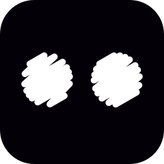
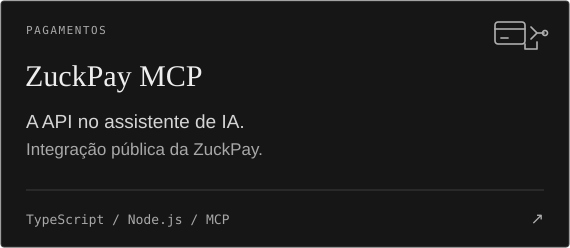

<picture>
<source media="(prefers-reduced-motion: reduce)" srcset="https://raw.githubusercontent.com/ocadubezerra/ocadubezerra/0c1bed1b9fad9f5d0ff2e3a8fe32e76a7097be26/assets/japanese-waves-static.svg">

</picture>

<picture>
<source media="(prefers-color-scheme: light) and (max-width: 640px)" srcset="https://raw.githubusercontent.com/ocadubezerra/ocadubezerra/488dc88204966af9d942fd80bf5030f807fab3d3/assets/profile-header-mobile-light.svg">
<source media="(max-width: 640px)" srcset="https://raw.githubusercontent.com/ocadubezerra/ocadubezerra/488dc88204966af9d942fd80bf5030f807fab3d3/assets/profile-header-mobile.svg">
<source media="(prefers-color-scheme: light)" srcset="https://raw.githubusercontent.com/ocadubezerra/ocadubezerra/488dc88204966af9d942fd80bf5030f807fab3d3/assets/profile-header-light.svg">

</picture>

 &nbsp;  &nbsp; 

**InfoProdutos, InfoApps, SaaS, sistemas de vendas e automações com IA para negócios reais.**

Comecei no digital em 2019, com dropshipping. Minha base é marketing, vendas e tráfego pago. Hoje também desenvolvo produtos e ajudo a escalar as operações que me chamam.

Sou fundador da **[ZuckPay](https://zuckpay.com.br)** e trabalho com o time na evolução da plataforma. Desenvolvi o KYC e diversas outras funcionalidades. Meu trabalho passa pelo produto, pelas integrações e pelo que acontece na operação.

Tenho participação em outros negócios, alguns fora da comunicação pública. Sou desenvolvedor entusiasta; uso Claude Code e Codex no dia a dia e continuo aprendendo enquanto construo.

### Tecnologias dos projetos

**Aplicações**

 &nbsp;
 &nbsp;
 &nbsp;
 &nbsp;
 &nbsp;

     

**Dados**

 &nbsp;
 &nbsp;

  

### DevOps & Ferramentas

 &nbsp;
 &nbsp;
 &nbsp;
 &nbsp;
 &nbsp;
 &nbsp;
 &nbsp;
 &nbsp;

        

## Projetos

 &nbsp; Conteúdo sobre inteligência artificial.

## Pull requests públicas integradas

| Projeto | Contribuição | Status |
| :--- | :--- | :---: |
| [ZuckPay MCP](https://github.com/ZuckPay/zuckpay-mcp) | [Reforço de segurança: limites de requisição, tratamento de erros e idempotência — PR #1](https://github.com/ZuckPay/zuckpay-mcp/pull/1) |  |

Contribuir e reportar problemas

[Guia de contribuição](CONTRIBUTING.md) · [Código de conduta](CODE_OF_CONDUCT.md) · [Relato de vulnerabilidades](SECURITY.md)

Cada projeto tem sua própria licença. [Autoria e marcas](RIGHTS.md) · [Procedência](NOTICE.md) · [Licença do perfil](LICENSE.md)

## <picture><source media="(prefers-color-scheme: light)" srcset="assets/contact-illustration-light.svg"></picture> Vamos construir seu próximo projeto?

Tem um negócio que precisa vender mais com tecnologia? [Me chama.](https://www.instagram.com/ocadubezerra/)

<a href="https://www.instagram.com/ocadubezerra/" title="Instagram · @ocadubezerra">
<picture>
<source media="(prefers-color-scheme: light)" srcset="https://raw.githubusercontent.com/ocadubezerra/ocadubezerra/488dc88204966af9d942fd80bf5030f807fab3d3/assets/contact-instagram-light.svg">

</picture>
</a>
<strong>Contato</strong>

 &nbsp;  &nbsp; 

<picture>
<source media="(prefers-reduced-motion: reduce)" srcset="https://raw.githubusercontent.com/ocadubezerra/ocadubezerra/0c1bed1b9fad9f5d0ff2e3a8fe32e76a7097be26/assets/japanese-waves-static.svg">

</picture>
