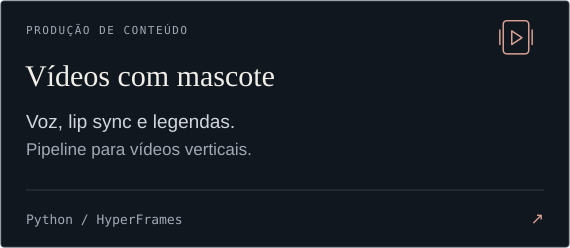

<picture>
<source media="(max-width: 640px)" srcset="assets/profile-header-mobile.svg">

</picture>

  <a href="https://zuckpay.com.br"><strong>ZuckPay</strong></a> &nbsp;·&nbsp;
  <a href="https://ia-thefuture.vercel.app"><strong>IA The Future</strong></a> &nbsp;·&nbsp;
  <a href="https://x.com/ocadubezerra"><strong>Conversar no X ↗</strong></a>

## Da operação ao produto

Estou no digital desde 2019, quando comecei com dropshipping. Minha base é marketing, vendas e tráfego pago. Hoje também atuo em SaaS, automação e desenvolvimento, conectando aquisição, produto e operação.

Sou desenvolvedor entusiasta e gosto de colocar a mão na construção. Uso Claude Code e Codex para desenvolver, testar ideias e evoluir funcionalidades, junto das pessoas que participam de cada projeto.

- **Aquisição e escala:** marketing, ofertas, tráfego pago e vendas. Apoio operações que me chamam para trabalhar no crescimento.
- **Produto e negócio:** participação em projetos e SaaS, construção de funcionalidades e melhoria da experiência de quem usa.
- **Tecnologia aplicada:** desenvolvimento, integrações e automação com IA como parte do trabalho de produto.

## ZuckPay e outras operações

&nbsp;
&nbsp;

Sou fundador da **[ZuckPay](https://zuckpay.com.br)** e trabalho junto ao time na evolução da plataforma. Desenvolvi o KYC — verificação de identidade — e diversas funcionalidades do produto. Minha atuação também passa por marketing, pagamentos e pelas necessidades da operação.

Tenho participação em outros projetos e SaaS e colaboro com operações em crescimento. Parte dessas participações fica fora da comunicação pública; aqui apresento o que posso compartilhar.

## Projetos públicos

**[IA The Future ↗](https://ia-thefuture.vercel.app)** — meu projeto de conteúdo sobre inteligência artificial.

Os cartões levam aos repositórios oficiais. As permissões de uso variam por projeto; consulte a licença de cada um. O código dos produtos privados permanece reservado.

## Trabalho em público, com responsabilidade

Uso este GitHub para compartilhar projetos, acompanhar contribuições e documentar o que pode ser aberto. A construção envolve pessoas, ferramentas e colaboração; o histórico preserva esses créditos.

- **Contribuições:** [atividade do perfil](https://github.com/ocadubezerra?tab=overview) e [propostas em revisão](https://github.com/ocadubezerra/ocadubezerra/pulls).
- **Colaboração:** [como contribuir](CONTRIBUTING.md) e [código de conduta](CODE_OF_CONDUCT.md).
- **Segurança e autoria:** [relato privado de falhas](SECURITY.md), [direitos e marca](RIGHTS.md) e [procedência](NOTICE.md).

Não publico detalhes de operações ou participações confidenciais. Os indicadores de atividade, licenças e verificações de cada projeto devem ser consultados no próprio repositório.

---

<a href="https://x.com/ocadubezerra">
<picture>
<source media="(max-width: 640px)" srcset="assets/profile-footer-mobile.svg">

</picture>
</a>

  <a href="https://x.com/ocadubezerra">X · @ocadubezerra</a> &nbsp;·&nbsp;
  <a href="https://zuckpay.com.br">ZuckPay</a> &nbsp;·&nbsp;
  <a href="https://ia-thefuture.vercel.app">IA The Future</a> 
  <a href="LICENSE.md">Direitos do material deste perfil</a> · <a href="RIGHTS.md">Autoria, marcas e licenças de terceiros</a>

